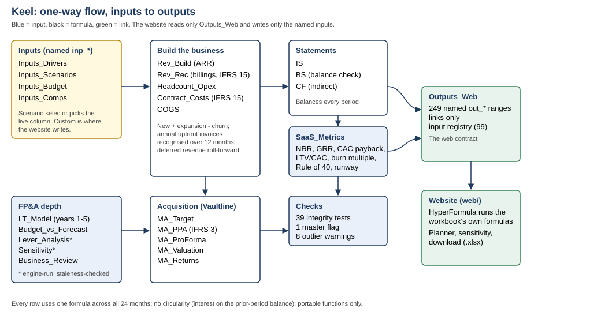

# Keel — SaaS operating model

A formula-driven model of a synthetic UK B2B SaaS company (*Northgate Controls Ltd*, about £40m ARR, growing about 30%, not yet profitable). Full project brief: `../FPA.md`.

**Status: all seven phases built (v0.7).** The workbook, the validation layer, the website and the scenario and sensitivity tools exist and pass 154 automated website checks plus the workbook validation. **Not done, and not doable by a tool:** nobody has looked at the site in a real browser, the file has not been opened in Excel or Google Sheets, the site is not deployed, and the manual rebuild (the model owner's task) has not been recorded. See *Your tasks* below.



## What is in the workbook

`model/keel_saas_model.xlsx`: 28 tabs, GBP thousands, 24 monthly periods plus FY1/FY2 columns, then a five-year view.

| Tab | Contents |
|---|---|
| `Cover` | Model map, version log |
| `Inputs_Drivers`, `Inputs_Scenarios` | Scenario selector and every named input (`inp_*`) with min/max and what it drives; Base / Upside / Downside / Custom values |
| `Rev_Build`, `Rev_Rec` | ARR waterfall by segment; annual-upfront billings, ratable revenue (IFRS 15), implementation fees, deferred revenue, receivables |
| `Headcount_Opex`, `Contract_Costs`, `COGS` | Headcount and payroll; capitalised sales commission and amortisation (IFRS 15); hosting and gross margin by stream |
| `IS`, `BS`, `CF` | Integrated three statements. The balance sheet balances with no plug after the opening date |
| `SaaS_Metrics` | ARR bridge, NRR, GRR, CAC, payback, LTV/CAC, magic number, burn multiple, runway, Rule of 40, and the levers behind each metric |
| `LT_Model` | Five-year view: years 1–2 linked to the monthly model, years 3–5 driver-based |
| `Inputs_Budget`, `Budget_vs_Forecast` | A board budget in a different layout (GBP m, quarters, costs negative); mapped variances and three bridges (ARR, revenue, EBITDA) |
| `Lever_Analysis`, `Sensitivity` | Impact of each driver on five metrics, top three levers per metric; two-way grids. **Static, engine-run tables** (see below) |
| `Business_Review` | One-page pack: live KPIs, what moved vs budget, risk flags, Base/Upside/Downside side by side |
| `MA_Target`, `MA_PPA`, `MA_ProForma` | Vaultline standalone; IFRS 3 purchase price allocation (IFRS vs US GAAP shown side by side); combined entity with eliminations, synergies, integration costs, intangible amortisation, own balance sheet |
| `MA_Valuation`, `Inputs_Comps`, `MA_Returns` | DCF, synthetic trading comps, offer range and football field chart; value created, break-even synergies, payback, ARR accretion, cash runway impact |
| `Outputs_Web` | **The web contract.** Links only. 249 named `out_*` ranges: scalar outputs, 24-month series for every statement and metric, the five-year view, budget bridges, football field, PPA, every check, and a registry of all 99 inputs (min, max, live value, scenario row) |
| `Checks` | 39 integrity tests with one global tolerance, rolled into one master flag (`chk_master`), plus 8 month-on-month outlier warnings (`chk_warnings`, review prompts that do not fail the model) |

Conventions: blue = input, black = formula, green = link to another tab, **grey italic = pasted engine-run value**. No circularity (interest uses prior-period cash). Only portable functions (no `OFFSET`, `INDIRECT`, `QUERY`).

### Why some tables are static

Excel and Google Sheets can't re-run a whole model for each cell of a grid without data tables (not portable). So `Lever_Analysis`, `Sensitivity` and the scenario block on `Business_Review` hold values produced by recalculating the full workbook (`validation/snapshots.py`). A check on the `Checks` tab compares the snapshot with the live Base model and fails if they drift. Change an input, and you must regenerate. The website (Phases 6–7) will compute these live.

## Rebuild and verify

The build is two passes, because the snapshots need a built workbook to run on. Use a virtualenv with `openpyxl` and `pycel`.

```
python model/build_model.py model/keel_saas_model.xlsx                       # pass 1 (writes snap_spec.json)
python validation/snapshots.py model/keel_saas_model.xlsx model/snap_spec.json model/snapshots.json
python model/build_model.py model/keel_saas_model.xlsx                       # pass 2 (pastes snapshots)
python validation/recalc_report.py model/keel_saas_model.xlsx Base           # checks + key outputs for any scenario (Base, Upside, Downside, Custom)
python validation/validate_model.py model/keel_saas_model.xlsx               # full independent validation -> validation/validation_report.md (about 2 minutes)
python validation/make_test_kit.py model/keel_saas_model.xlsx model/snapshots.json tests/   # regenerates the hand-verification and portability kit
```

`build_model.py` only lays out formulas. All calculation lives in the workbook.

## Verified so far (independent recalculation with pycel, not Excel)

All 39 checks pass in Base, Upside and Custom. **In the Downside the master flag is deliberately red:** the deal leaves the pro-forma business with negative cash (check "Pro-forma cash never negative").

| Scenario | ARR M12 → M24 (£k) | FY1 / FY2 EBITDA (£k) | Cash M24 (£k) |
|---|---|---|---|
| Base | 53,404 → 68,321 | −6,972 / −3,129 | 22,579 |
| Upside | 58,460 → 80,599 | −5,720 / +1,192 | 31,968 |
| Downside | 45,146 → 50,209 | −8,479 / −7,575 | 9,508 |

Acquisition (Vaultline at 4.5x ARR, £27.0m EV): value created **+£7.3m Base, +£16.8m Upside, −£12.6m Downside**; break-even needs 54% of planned synergies. Switching the deal off (`inp_ma_include` = 0) reproduces Northgate standalone exactly. See `docs/acquisition_memo.md`.

Base FY1 against the synthetic budget: exit ARR £1.1m below (volume and churn, partly offset by price and expansion), EBITDA £1.2m below. See `docs/q3_business_review.md`.

## Validation (Phase 4)

`validation/validate_model.py` is an independent check that does not reuse the workbook's own check formulas. Latest run (`validation/validation_report.md`): **32 passed, 0 failed, 2 review items, 1 expected.**

- **Independent model:** a second implementation of the Northgate model (and of Vaultline goodwill) in plain Python agrees with the workbook to within 0.01 GBP k on 13 outputs in every scenario.
- **Test the tests:** five deliberate breakages (a hardcoded cash-flow line, a broken ARR roll-forward, an out-of-range input, negative billings, a bad total) are each caught by the workbook's checks.
- **Static scans:** no hardcoded numbers in forecast ranges, one consistent formula across all 24 periods in 308 rows, no non-portable functions in 10,980 formulas, no undefined names, every typed number marked as an input or snapshot.
- **Expected:** the Downside master check is red because the deal leaves the pro-forma business with negative cash.
- **Web contract:** 249 `out_*` ranges all sit on `Outputs_Web`; the input registry lists every `inp_*` name; `Outputs_Web` contains only links; all 5,469 of its cells evaluate without error.
- **Portability inventory:** 21 classic functions only, `INDEX` always with explicit row and column, no array arithmetic inside `SUMPRODUCT` (which HyperFormula disables by default), formulas far inside Excel's length and nesting limits.
- `docs/ai_usage.md` lists what was automated, what stays a human judgement, and every mistake that was caught.

## The website (Phases 6 and 7)

`web/` is a static site (HyperFormula + SheetJS + ExcelJS + Chart.js) that runs the workbook's own formulas in the browser. See `web/README.md` for how to run it, what was verified, and what was not. Headline: the browser engine reproduces all 5,469 `Outputs_Web` cells in Base, Upside and Downside; 154 automated checks pass in seven suites (`cd web && npm install && npm test`); **no real browser has rendered it yet**, so layout and first-load time are unverified. Licence: GPL-3.0 (HyperFormula is GPL-3.0). A GitHub Pages workflow (`.github/workflows/pages.yml`, which runs the tests before publishing) is ready, but the site is not deployed.

Sections 9 and 10 are built: a scenario planner (presets, up to 4 saved scenarios, 2-4 way comparison, input diff, downside flags, acquisition overlay, scenario bridge) and a sensitivity tool (tornado, 7 x 7 two-way grid, goal seek, acquisition grid, CSV for every table). The acceptance tests in `tests/acceptance_checklist.md` pass against independent recalculations except the Excel step of test 2.

### The contract with the website

- The website reads only the `out_*` names and writes only the `inp_*` names. `model/named_ranges.json` lists all 355 names with their addresses, ready to register in the browser engine.
- A scenario-driven input is a formula on `Inputs_Drivers` (it picks a scenario column). To change one, write to its `Inputs_Scenarios` **Custom** column (the registry gives the row) and set `inp_scenario` to `Custom`. Static inputs are written directly.
- The football-field chart exists in `model/keel_saas_model.xlsx` only; `model/keel_saas_model_web.xlsx` (used by the site) omits it because ExcelJS cannot read the chart drawing.
- Static tables (`Lever_Analysis`, `Sensitivity` grids 1-2, `Business_Review` section 3, `MA_Returns` section E) are not part of the contract: the site computes those live.

### What the tools say about Northgate and Vaultline (Base, synthetic data)

- **Which assumption matters most (±10%):** ARR in month 24 moves most with new Enterprise logos per month, then Enterprise deal size, then Enterprise expansion. Cash and FY2 EBITDA move most with R&D and S&M cost per head. The deal's value moves most with the discount rate, then the offer multiple, then synergies achieved.
- **Goal seek:** Enterprise churn would have to reach 16.3% (against 6% in Base) to take the lowest month-end cash down to £15m. The deal creates exactly zero value at an offer of 5.70x ARR (Base synergies); the recommended ceiling in `docs/acquisition_memo.md` is about 4.0x.
- **Bridge:** moving from Base to Downside removes £18.1m from month-24 ARR across 19 changed drivers; the contribution of each depends on the order they are applied, and the page says so.

## Your tasks (none of these can be done by a tool)

1. **Look at the website:** `cd web && python3 -m http.server 8000`, open it on a laptop and a phone, try dark mode, the planner and every sensitivity tool, and note what is wrong. Nothing has been rendered in a real browser. Then capture the screenshots and a short GIF walkthrough (`screenshots/README.md` lists what to capture); the brief asks for them in this README and I cannot make them.
2. **Manual rebuild:** `tests/manual_verification.md` and `tests/manual_rebuild_template.xlsx`. Rebuild the ARR bridge, deferred revenue roll-forward and goodwill on blank sheets and match 20 target numbers.
3. **Open the file in Excel and Google Sheets:** `tests/portability_checklist.md`, with expected values in `tests/expected_values.csv`.

## Not done yet

- **Not opened in Excel or Google Sheets.** The portability pass is done by inspection and automated scans only; the checklist above is how you close it.
- **Not checked by hand.** The Python model is not a substitute: it was written from the same understanding as the workbook. The brief requires you to rebuild the ARR bridge, deferred revenue roll-forward and goodwill independently (Phase 5). Phase 2 itself found one formula bug that a hand check would have caught: annual "opening" columns showed 0 for FY1 (fixed in v0.2).
- No screenshots, no GIF walkthrough and no view-only Google Sheet link yet (they need a real browser and your Google account).
- Deployment: push the repository and enable GitHub Pages (Source: GitHub Actions); then add the site link here.
- The `Lever_Analysis` step sizes are labels for the snapshot run; changing them in the sheet does not rerun it.
- Early-month runway figures use fewer than three months of burn history; read runway from month 3 onward.
- All simplifications are in `docs/assumption_log.md` (41 items). M&A inputs, comps and synergies are illustrative assumptions.
- The football field chart has not been viewed in Excel or Sheets (built with openpyxl).
